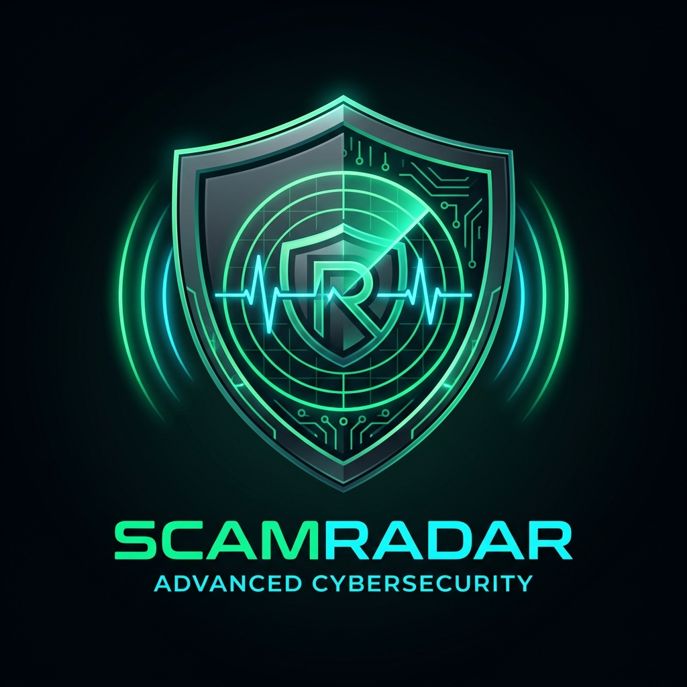

<p align="center">
  
</p>

<h1 align="center">ScamRadar</h1>

<p align="center">
  <strong>AI-Powered Cybersecurity Platform for Real-Time Scam Detection & Threat Intelligence</strong>
</p>

<p align="center">
  
  
  
  
  
</p>

---

## 📌 Executive Summary

**ScamRadar** is an advanced, multimodal cybersecurity defense system engineered to detect, expose, and neutralize emerging social engineering fraud before financial loss occurs. Powered by **Google Gemini 2.5 Flash Vision** and **Speech-to-Text Neural Transcription**, ScamRadar intercepts the most pervasive modern cyber threats—including **WhatsApp Digital Arrest extortion**, **counterfeit UPI payment QR codes**, **Telegram part-time task Ponzi schemes**, and **generative AI voice cloning emergency scams**.

---

## 🎯 Core Capabilities

| Capability | Engine | Description |
| :--- | :--- | :--- |
| **Vision OCR Threat Scanner** | Gemini 2.5 Vision | Inspects WhatsApp conversations, spoofed bank SMS alerts, and malicious payment QR codes for psychological extortion signatures. |
| **Audio Deepfake & Vishing Engine** | Neural Speech Analysis | Transcribes recorded emergency calls, flags panic triggers, and detects synthetic voice cloning vectors. |
| **3D Interactive Cyber Radar** | HTML5 3D Matrix | Real-time interactive holographic canvas with mobile touch-gesture tilt physics simulating global cyber threat coordinates. |
| **Evidence Upload Modal** | SHA-256 Memory Staging | Instant popup confirmation with verified vector integrity status and immediate scan execution triggers. |
| **Role-Based Access Control** | Dual-Role Architecture | Dedicated sign-in pathways for **Enterprise Threat Analysts (User)** and **Security Operations Center Analysts (Admin)**. |
| **SOC Operations Console** | Telemetry & Case Management | Comprehensive administrative dashboard for tracking system-wide incidents, moderation tables, and risk metrics. |
| **Interactive Threat Simulation Lab** | Scenario Engine | Testable simulations of Digital Arrests, UPI traps, and AI Voice clones with threat score breakdowns. |

---

## 🏗️ System Architecture

```text
       [ WhatsApp Screenshot ]          [ Phone Call Recording ]
                 │                                 │
                 ▼                                 ▼
      ┌─────────────────────┐           ┌─────────────────────┐
      │ Gemini Vision (OCR) │           │ Speech Transcription│
      └──────────┬──────────┘           └──────────┬──────────┘
                 │                                 │
                 └───────────────┬─────────────────┘
                                 │
                                 ▼
                   ┌───────────────────────────┐
                   │ Neural Threat Classifier  │
                   └─────────────┬─────────────┘
                                 │
                 ┌───────────────┴───────────────┐
                 ▼                               ▼
       [ Confidence Score % ]          [ Preventive Guidance ]
       [ Threat Classification]        [ Emergency 1930 Portal]
```

---

## 🔑 Access Roles & Demo Accounts

| Role | Email | Password | Scope & Privileges |
| :--- | :--- | :--- | :--- |
| **Regular User** | `user@enterprise.com` | `user123` | Upload evidence, execute multimodal AI scans, view personal scan reports, access AI assistant |
| **System Admin** | `admin@scamradar.com` | `admin123` | Full SOC telemetry console, global case inspection, evidence logs, system moderation |

---

## 🚀 Quick Start Guide

### Prerequisites
* **Node.js** (v18.0 or higher)
* **Python** (v3.10 or higher)
* **Git**

### 1. Clone Repository
```bash
git clone https://github.com/TumukuntaSrivalli/ScamRadar-AI_Powered_Scam_Detection-and-Prevention_System.git
cd ScamRadar-AI_Powered_Scam_Detection-and-Prevention_System
```

### 2. Launch Backend (FastAPI)
```bash
cd backend
python -m pip install -r requirements.txt
python -m uvicorn main:app --host 0.0.0.0 --port 8000 --reload
```
* **API Documentation (Swagger UI)**: `http://127.0.0.1:8000/docs`

### 3. Launch Frontend (React + Vite)
```bash
cd ../frontend
npm install
npm run dev
```

* **Local Machine Access**: `http://localhost:5173/`
* **Mobile Phone Access (Same Wi-Fi)**: `http://<your-ip-address>:5173/`

---

## 📱 Mobile Device Optimization

ScamRadar is fully responsive and optimized for all form factors:
* **Gesture-Controlled 3D Canvas**: Touch-and-swipe rotation enabled for iOS and Android browsers.
* **Collapsible Mobile Navigation**: Quick-access drawer menu with role status and navigation tabs.
* **Safe-Viewport Modals**: Scrollable authentication and file confirmation modals resilient to on-screen virtual keyboards.

---

## 🌐 Production Deployment

### Deploy to Vercel (One-Click)
Deploy directly from your GitHub repository using the pre-configured [`vercel.json`](vercel.json):

[](https://vercel.com/new/clone?repository-url=https%3A%2F%2Fgithub.com%2FTumukuntaSrivalli%2FScamRadar-AI_Powered_Scam_Detection-and-Prevention_System)

Or via Vercel CLI:
```bash
npx vercel --prod
```

---

## 🚨 Emergency Reporting Helplines

If you or someone you know has been victimized by financial cyber fraud:
* **National Cyber Crime Reporting Helpline (India)**: Dial **1930**
* **Official Cyber Crime Portal**: [https://cybercrime.gov.in](https://cybercrime.gov.in)

---

## 📄 License & Intellectual Property

Distributed under the MIT License. Developed for enterprise fraud prevention, cyber threat intelligence, and user empowerment.
